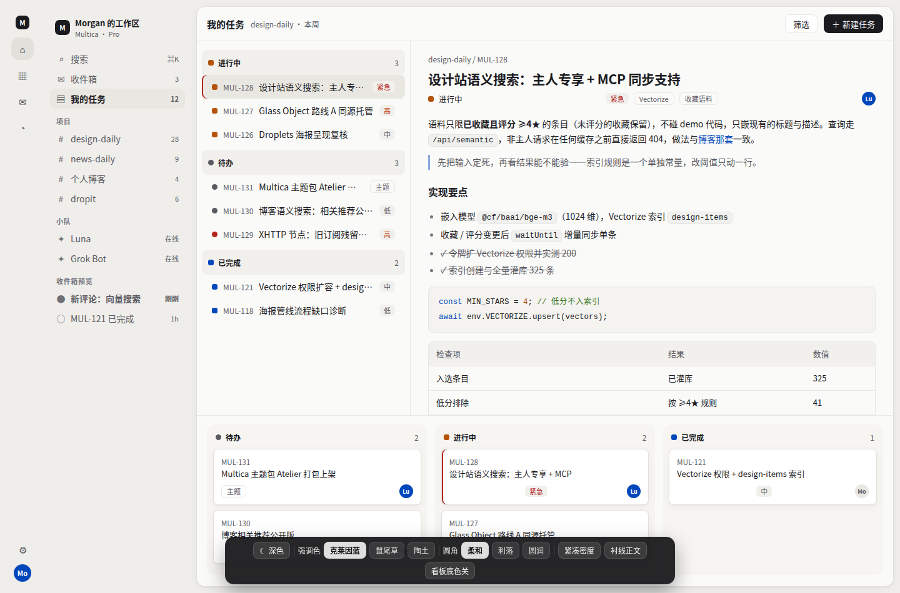
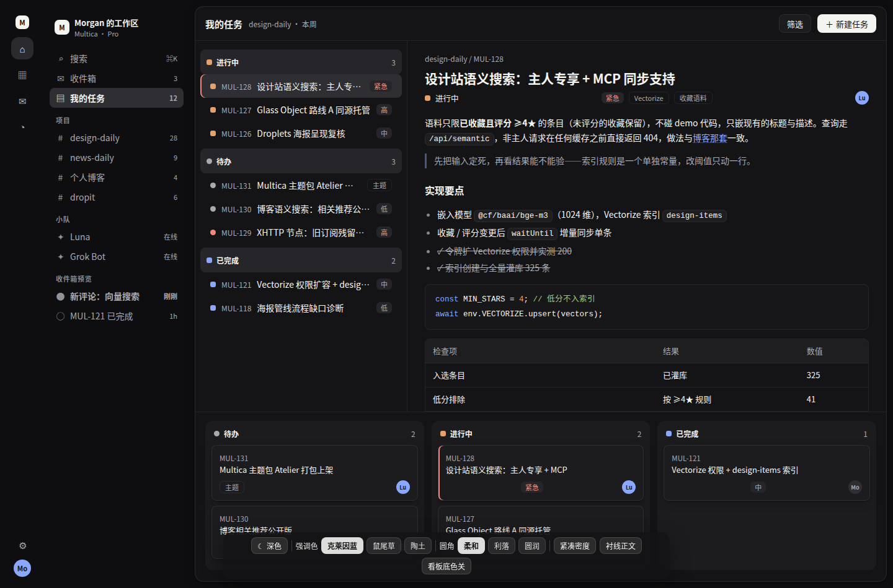

# Atelier Graphite

Warm graphite layers with a single accent dot, for [Multica](https://multica.ai).
暖石墨灰阶 + 单点强调色的 Multica 主题：层次只靠灰阶与发丝线，主按钮是石墨黑/纸白，强调色只做小点（当前、链接、已完成）。

> 预览图是拟真 Multica 界面（任务列表 + 打开的任务 + 看板）套上本主题渲染的，不是 Multica 本体截图。

## Install 安装

- 在 Multica 的 **设置 → 外观 → Manage** 里（上架主题商店后）安装；或
- 从本仓库的 [latest release](../../releases/latest) 下载 `theme.zip`，在 **设置 → 外观 → 导入主题** 里导入它；或
- 直接导入本仓库根目录这个文件夹（`manifest.json` + `theme.css`）。

主题出问题时：地址后加 `?theme=default`，或加载后立刻按住 Shift。

## Options 主题选项

导入后在外观页的 **主题选项** 里调整，共 9 个：

| 选项 | 说明 |
|---|---|
| 强调色 | 克莱因蓝 `#0047BB`（默认）/ 鼠尾草绿 / 陶土橙，深色模式自动换浅一号同系色 |
| 页面底色 | 浅/深各一色，默认纸白 `#FAFAF8` / 墨黑 `#141416` |
| 圆角 | 柔和 8px / 利落 3px / 圆润 12px，全套圆角同心派生 |
| 密度 | 舒展（行高 38px）/ 紧凑（32px） |
| 字体 | 默认微软雅黑优先：`"Microsoft YaHei", "PingFang SC", "Noto Sans CJK SC", Inter`——Windows 雅黑、苹果苹方、Linux/安卓思源黑体；外观页手动选的字体仍会盖过主题 |
| 正文衬线体 | 开关：内容区拉丁字体切 Georgia、H1 斜体 |
| 阅读宽度 | 滑杆 38–64rem，默认 48 |
| 看板列底色 | 关掉后看板列透明 |

## Design 设计依据

- 只使用 Multica 官方公开变量与 `data-mc` 锚点（见官方仓库 `docs/theming.md`），不碰类名与 DOM 结构。
- 侧栏做法参考 Mobbin 上 Linear / Notion 的真实界面（次要灰文字、灰药丸选中行）；双调色参考 21st.dev 的 Dashboard Sidebar（id 14941，Charcoal Ink / Alabaster）与 Kanban Board（id 24340）。
- WCAG AA：前景/次要文字/强调色在浅与深两种模式、三个强调色下均 ≥ 4.5:1（开发时逐项测过）。

## Make your own / 发布新版

1. 改 `manifest.json` 的 `id`、`name`、`author`（做你自己的主题时）。
2. 改 `theme.css`。
3. 检查：在 `multica-ai/multica` 的本地副本里跑 `pnpm theme:check <本文件夹>`。
4. 发布：把 `manifest.json` 的 `version` 升版，打同名 tag（如 `v1.0.2`）并推送——Release 工作流会校验 tag 与 version 一致，并把 `theme.zip` 附到 release 上。
5. 上架商店：向 [multica-ai/multica-themes](https://github.com/multica-ai/multica-themes) 提 PR，新增 `themes/atelier.json`。

主题格式是 Beta API：变量、锚点与 manifest 都可能变化。

## License

MIT
